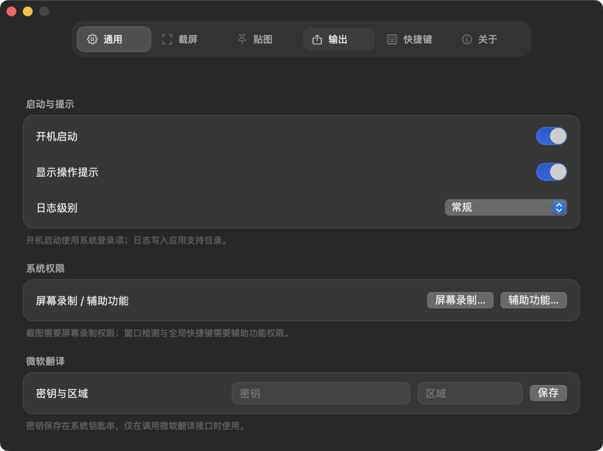
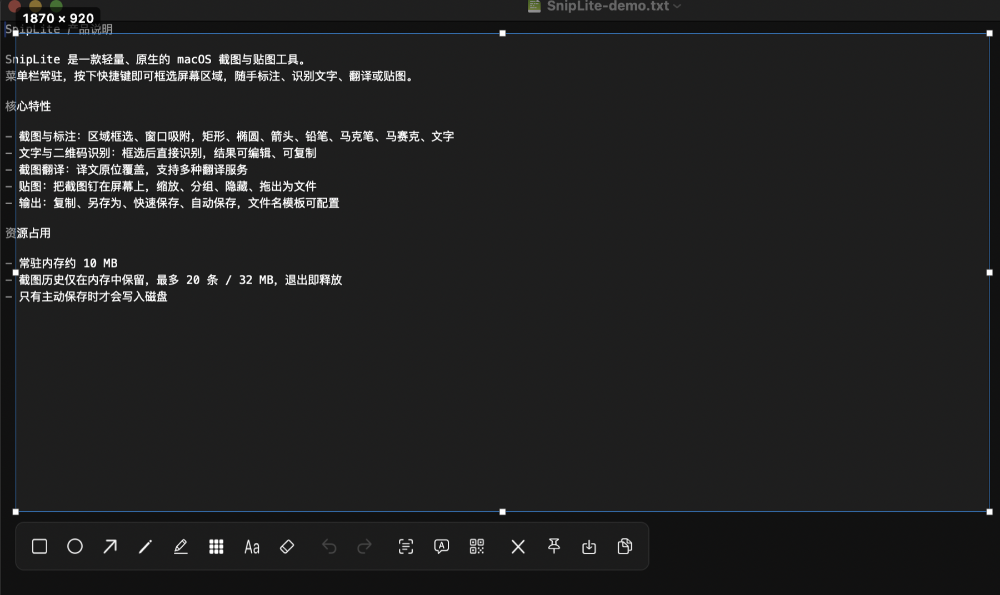

# SnipLite

轻量、原生的 macOS 截图与贴图工具。菜单栏常驻，只做截图相关的事，不占后台资源。

## 界面预览





## 功能

- **截图**：区域框选、窗口吸附、8 种标注工具（矩形 / 椭圆 / 箭头 / 铅笔 / 马克笔 / 马赛克 / 文字 / 橡皮），支持撤销重做
- **识别**：文字识别（OCR）、二维码识别、截图翻译（译文原位覆盖，支持 Google / 微软 / DeepL 等）
- **贴图**：把截图钉在屏幕上，可缩放、分组、隐藏、拖出为文件，关闭后可恢复
- **输出**：复制到剪贴板、另存为、快速保存、自动保存，文件名模板可配置
- **定制**：全局快捷键可改，深色 / 浅色自动跟随系统

## 安装

1. 下载 `SnipLite-x.y.z.dmg`，双击打开
2. 把 SnipLite 拖到 Applications
3. 首次截图时按系统提示授予**屏幕录制**权限；窗口检测和全局快捷键需要**辅助功能**权限
4. 应用未做 Apple 公证，首次打开若被拦截：右键 →「打开」，或到「系统设置 → 隐私与安全性」里点「仍要打开」

## 使用

| 操作 | 快捷键 |
|---|---|
| 截图 | `⌃⌘A` |
| 贴图 / 恢复贴图 | `⌃⌘S` |
| 文字识别 | `⌃⌘O` |
| 二维码识别 | `⌃⌘Q` |
| 截图翻译 | `⌃⌘T` |
| 打开设置 | 菜单栏菜单 → 设置… |

截图过程中：

| 操作 | 说明 |
|---|---|
| `Esc` | 退出截图 |
| `Enter` | 复制并退出 |
| `⌘C` | 复制，继续编辑 |
| `⌘T` | 贴到屏幕上 |
| `⌘S` | 另存为 |
| `⌘Z` / `⇧⌘Z` | 撤销 / 重做 |
| `R` `E` `A` `P` `M` `X` `T` `H` | 切换矩形 / 椭圆 / 箭头 / 铅笔 / 马克笔 / 马赛克 / 文字 / 橡皮 |
| 双击选区 | 执行默认动作（默认复制并退出） |

所有快捷键都可以在「设置 → 快捷键」里重新录制。

## 隐私与资源占用

- **历史记录只在内存里**：最多 20 条、压缩后总量 32MB，超出自动淘汰最旧的，退出 App 立即释放
- **不主动写盘**：只有你执行另存为 / 快速保存 / 开启自动保存时才会保存文件
- 常驻内存约 **10MB**；一次截图完成后回落到约 110MB 并保持稳定，不随截图次数增长
- 截图只在设备本地处理，OCR、二维码、翻译都在本机或你配置的翻译服务中完成

## 系统要求

macOS 15.0 及以上（Apple Silicon / Intel）。

## 构建

需要 Xcode 26 和 [XcodeGen](https://github.com/yonaskolb/XcodeGen)。

```bash
# 生成工程并构建
xcodegen generate
xcodebuild -project SnipLite.xcodeproj -scheme SnipLite -configuration Debug build

# 打 Release 包并生成 DMG
./package.sh

# 运行测试
xcodebuild -project SnipLite.xcodeproj -scheme SnipLiteCore test
```

产物：`build/SnipLite-x.y.z.dmg`。

## 项目结构

```
Sources/SnipLiteCore/   无 UI 的模型与算法（设置、OCR 文档、翻译、标注渲染）
Sources/SnipLite/       应用本体（菜单栏、截图遮罩、贴图、设置页）
Tests/                  XCTest
```

## 签名

开发期使用本地自签名证书 `SnipLite Local Signing`（`~/Library/Keychains/sniplite-signing.keychain-db`），避免每次重新编译后 macOS 重置屏幕录制权限。正式分发需要替换为 Developer ID 证书并公证：

```bash
codesign --deep --force --options runtime --sign "Developer ID Application: ..." SnipLite.app
xcrun notarytool submit SnipLite-x.y.z.dmg --apple-id ... --team-id ... --password ... --wait
xcrun stapler staple SnipLite-x.y.z.dmg
```

## 配置与日志

- 设置：`~/Library/Application Support/SnipLite/settings.json`
- 日志：`~/Library/Application Support/SnipLite/app.log`

## License

MIT
